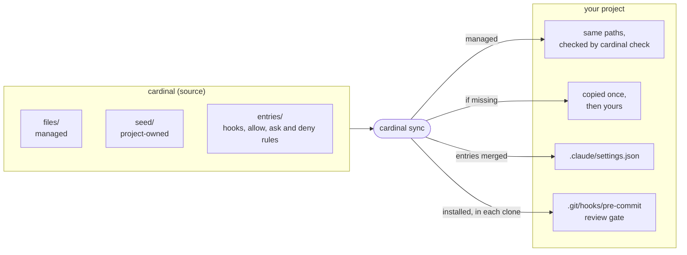
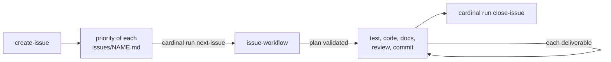

<p align="center"></p>

# Cardinal

Cardinal is one agent harness for many projects. This repository holds the Claude Code skills, hooks, checks, optional `just`
recipes and CI that a project needs to have an agent work its issues safely, plus `cardinal`, the tool that copies them
into each project and tells when a copy drifted.

New to Cardinal? Start with the **[tutorial](docs/tutorial.md)**: from an empty project to a first issue delivered by
the agent.

This README has two parts: [Use Cardinal](#use-cardinal) in a project (the `cardinal` binary, nothing else needed) and
[Develop Cardinal](#develop-cardinal) itself (a clone, `cargo`, `just`).

# Use Cardinal

## What a project gets

| | |
|---|---|
| Skills | `issue-workflow` (an issue driven to done in validated deliverables), `create-issue`, `prioritize-issues`, `write-spec`, `update-docs`, `commit-message`, `evaluate-harness`, `audit-instructions` |
| Rules | `.claude/rules/user-language.md`: the language of the conversation, `.claude/rules/reports-to-the-user.md`: the format of the reports to the user, and `.claude/rules/no-ai-attribution.md`, loaded in every session with no edit of the project's `CLAUDE.md` |
| Optional features | `disabled` in `.claude/cardinal.toml` turns off a feature of `features.toml` (`no-ai-attribution`, `conventional-commits`, `lint-gate`, `format-code`, `language-hint`, `read-hint`, `review-gate`, `harness-measure`, `report-style`, `github-ci`, `issue-files`, `specs`, `workspace-lock`): `sync` removes its files and entries |
| Gates | no commit without a code review of the diff, no `git add` of every file, no turn ending on a warning of the project's lint (clippy by default), a reply not in the `user_language` sent back once, a whole read of a large file sent back once, the project's formatter (`cargo fmt` by default) after each edit, one Claude Code session per worktree; commit messages checked (Conventional Commits, no AI attribution, each a feature) |
| Recipes | `cardinal.just` (`open-worktree`, `check-cardinal`, `release`…), which imports the recipes of each part a feature may leave out when present: `cardinal-issues.just` (`next-issue`, `close-issue`, `check-issue`, `roadmap`), `cardinal-specs.just` (`check-specs`, `spec-coverage`), `cardinal-commits.just` (`check-commit`, `check-commits`), `cardinal-review.just` (`waive-review`) |
| Project check | `cardinal run project-check` (the seeded `just check` calls it): the `check_command` of `.claude/cardinal.toml`, quiet on success, then the specs; it fails while no command is declared |
| Releases | `cardinal run release` (alias `just release`): the next semver proposed from the commits, its `CHANGELOG.md` section written to reread, then a local `v<version>` tag; an agent writes the section and the tag only with the user's permission (managed ask rules) |
| CI | `.github/workflows/cardinal.yml`: the copies and the specs checked on main and on each pull request, plus its commit messages |
| Evaluation | `cardinal run session-metrics`, `rule-breaches`, `delivered-quality`…: did a Cardinal revision make the agent better? |



## Install

Download the `cardinal` binary of the latest release (`x86_64-unknown-linux-musl`, `aarch64-unknown-linux-musl` or
`aarch64-apple-darwin`) into a directory of your `PATH`, then adopt Cardinal in a git repository:

```sh
target=x86_64-unknown-linux-musl
curl -fsSL -o ~/.local/bin/cardinal \
  "https://github.com/Electron-libre/cardinal/releases/latest/download/cardinal-$target"
chmod +x ~/.local/bin/cardinal
cd my-project
cardinal init https://github.com/Electron-libre/cardinal.git   # writes .claude/cardinal.toml
cardinal update                                                # pins the latest commit, then syncs
```

No clone of this repository and no `just` needed: [`just`](https://github.com/casey/just#installation) is optional, its
recipes are aliases of `cardinal run …`. The checksum, the other platforms and what `sync` prints:
[docs/tutorial.md](docs/tutorial.md#1-install-the-tools).

Then keep the Claude Code transcripts a year, the evaluation reads them:
`{ "cleanupPeriodDays": 365 }` in `~/.claude/settings.json`.

## Commands

| Command | Does |
|---|---|
| `cardinal init <source> [--rev <rev>]` | points the project at a source (a directory or a git URL) in `.claude/cardinal.toml` |
| `cardinal sync [--dry-run] [--force]` | brings the project in step with its source |
| `cardinal update [--rev <rev>] [--dry-run] [--force]` | moves a git source to a revision, syncs, pins the commit |
| `cardinal check` | fails when a copy drifted, the review gate is missing or a hook needs a newer `cardinal` |
| `cardinal upgrade <source> <commit>` | replaces the installed `cardinal` with the one of a commit: its release binary, checked against its SHA-256, else built with `cargo` |
| `cardinal run [<tool>]` | runs a tool of the pinned revision (hooks, checks, transcript readers); alone, lists them |

## Daily flow



Tell the agent `issues/<name>.md` (or "the next issue"); it prepares a plan, stops once for your validation, then
delivers. Details: [docs/workflow.md](docs/workflow.md).

## Read next

- [docs/tutorial.md](docs/tutorial.md): a first walk through, from an empty project to a first issue delivered.
- [docs/usage.md](docs/usage.md): every command in detail, the evaluation, parallel worktrees.
- [docs/workflow.md](docs/workflow.md): how an issue goes from idea to merge, alone or in parallel.
- [docs/gates.md](docs/gates.md) and [docs/evaluation.md](docs/evaluation.md): the detail of the hooks and of the
  evaluation.

# Develop Cardinal

For who changes Cardinal itself, not for a project that uses it. This repository is its own first consumer: its
`.claude/`, `.github/` (the CI of a consumer), `AGENTS.md`, `cardinal*.just` and `specs/README.md` are copies of
`files/`.

```sh
git clone https://github.com/Electron-libre/cardinal.git && cd cardinal
just install          # cargo install --force --path crates/cardinal --locked
just check            # fmt, clippy -D warnings, tests, spec traceability: before each commit
just sync             # after a change of files/: refresh the copies of this repository
just check-cardinal   # fails when a copy drifted
```

| Path | Holds |
|---|---|
| `files/` | the managed content, copied to the same path of every consumer: fix it here, never in a copy |
| `seed/` | the project-owned starting points, copied once |
| `entries/.claude/settings.json` | the hooks and the allow, ask and deny rules `sync` keeps in each project |
| `features.toml` | the features a project may turn off |
| `crates/cardinal/` | the `cardinal` binary and the tools of `cardinal run` |
| `specs/` | what each capability must do, traced to its tests by `// spec: ID` |
| `issues/`, `docs/adr/` | the open issues, the decisions |
| `fixtures/replay/` | the project `just replay <rev> <runs>` runs headless against a revision (billed) |

- [docs/architecture.md](docs/architecture.md): how Cardinal is built.
- [specs/](specs/): what each capability must do; [docs/adr/](docs/adr/): why it is so.
- [CLAUDE.md](CLAUDE.md): the conventions of this repository (commits, tests, formats and migrations).
