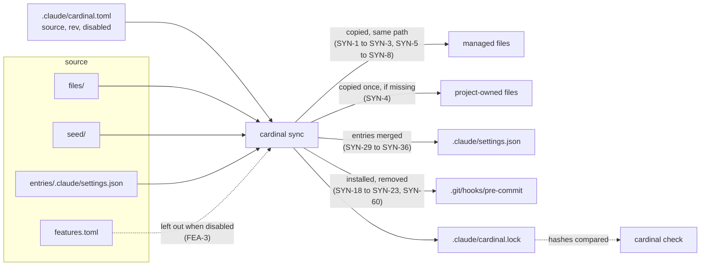
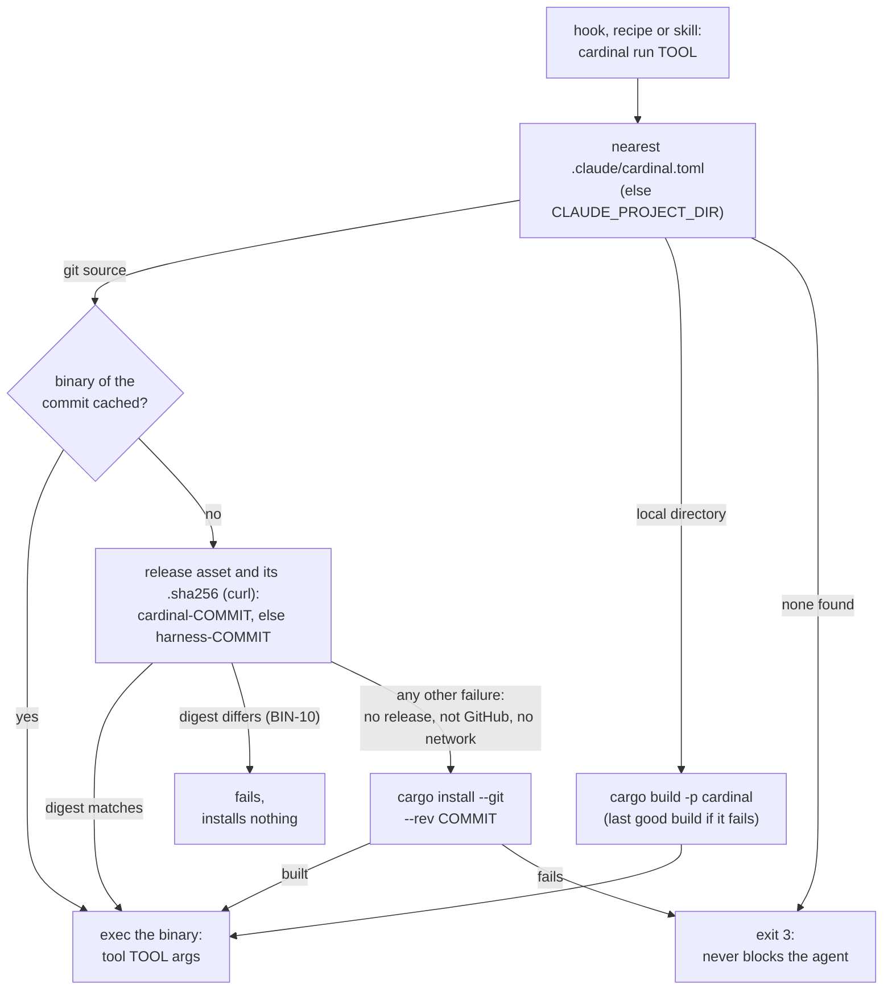

# Architecture

How Cardinal is built. This page covers the sync, the binary and the hooks; two pages hold the detail:

- [gates.md](gates.md): the review gate and the code hooks.
- [evaluation.md](evaluation.md): how Cardinal is judged from the transcripts and the replay runs.

## What is shared, and how

A consumer project holds a `.claude/cardinal.toml`: the `[cardinal]` table (`source`, `rev` for a git source, and the
`disabled` features) and its own values (`[project]`, read by the tools and the skills). `cardinal sync` reads the source, writes three kinds of
files, records them in the lock and installs the review gate
([ADR 0001](adr/0001-shared-harness-synced-by-a-rust-tool.md), spec [`specs/sync.md`](../specs/sync.md)):

| Kind | From | Examples | Owner |
|---|---|---|---|
| Managed | `files/` | skills, `.claude/rules/` (always-on rules, loaded at launch with no import), `.claude/.gitignore` (ignores the personal configuration), `cardinal.just` and the `cardinal-<part>.just` it imports when present (the recipes of a part a feature may leave out), `AGENTS.md`, `specs/README.md`, the CI workflow and its `install_cardinal.sh` | the source: an edit in a project is a conflict |
| Seeded | `seed/` | `.claude/cardinal.toml` defaults, `.claude/settings.json`, `.claude/update-docs-map.md`, `justfile`, `ROADMAP.md` (the milestones the `roadmap` key points at), `CHANGELOG.md` (the header of the sections `release` writes) | the project, from the first copy |
| Entries | `entries/.claude/settings.json` | the hooks, the deny rules of the review waiver, the allow rule of `cardinal run` and the ask rules of `release` | the source, inside a file the project owns ("Hooks and their declaration") |

`.claude/cardinal.lock` records the hash of each managed file and each managed entry as written, and the format of
the source it was synced from. A managed file whose hash differs from the lock was edited locally: `sync` reports a
conflict instead of overwriting it and `check` fails. The fix belongs in this repository, then `sync` everywhere;
there is deliberately no merge.

A source may group managed files and entries into named features in `features.toml`; a project lists those it
turns off in the `disabled` list of its `[cardinal]` table, and `sync` handles them as content the source does not
manage, so the removal, conflict and lock rules above apply unchanged and `check` knows nothing of features; `sync`
refuses a `disabled` list that turns off a feature one left on `needs`
([ADR 0025](adr/0025-a-project-turns-off-a-feature-at-sync.md), spec [`specs/features.md`](../specs/features.md)).

Everything that differs between projects is a value of `.claude/cardinal.toml`, not code:

| Read by | Keys |
|---|---|
| the tools | `commit_scopes`, `root_docs`, `skipped_dirs`, `spec_files`, `internal_dirs`, `release_breaking_files` |
| the hooks and `release` | `lint_command`, `lint_files`, `format_command`, `format_files`, `release_version_command` |
| `deliverable-size` | `deliverable_size_limit`, `issue_size_limit` |
| `cardinal` itself | `fixed_context_budget`, and `disabled` of the `[cardinal]` table |
| the skills, through the agent | `roadmap`, `architecture`, `test_conventions`, `confidential`, `user_language` |

The change-to-documents table of `update-docs` is the project's `.claude/update-docs-map.md`. Anything else
project-specific (a quality benchmark, a smoke test, the language-specific recipes of the `justfile`) stays in the
project.

A preference of the person rather than of the project (`user_language` today) is read first from the `[project]`
table of `.claude/cardinal.local.toml`, a file each person writes, git ignores and Cardinal never manages, then from
`.claude/cardinal.toml`, which keeps the default
([ADR 0018](adr/0018-personal-preferences-live-in-a-git-ignored-file.md)).

## Sources

A source is a directory (relative to the project) or a git repository: a URL, or a path ending with `.git` (SYN-49),
read as the absolute `file://` URL of that path from the project root (SYN-50). A git source is cloned in
`$XDG_CACHE_HOME/cardinal` and checked out at `rev` (default: the remote's default branch), which pins a commit, not
a moving name ([ADR 0002](adr/0002-rev-pins-the-resolved-commit.md)). `cardinal update [--rev <name>]` resolves a name
to a commit, previews the sync, and only then syncs and writes the commit to `rev` (SYN-11 to SYN-17); once it changed
a file, it names `skill:commit-message` as the next step (SYN-61). A local directory has no revision. `check` compares
the project with its lock and never reads the source.

A source declares the format of its managed content in `cardinal-format`; `cardinal` reads up to the `FORMAT` compiled
in it and refuses a higher one, as well as a source below the format 5 (the issues ordered by `issues/queue.md`,
ADR 0020). A source that raises its format declares the names and seeded texts it replaced in `migrations/<n>.toml`
(`crates/cardinal/src/migration.rs`, ADR 0014, ADR 0017); [usage.md](usage.md#formats-and-migrations) says what each
command does with them.

## Tools and their binary

The tools of Cardinal (hooks, checks, issue tools, transcript readers) are modules of the `cardinal` crate, one per
tool under `crates/cardinal/src/tools/`, listed in `TOOLS`
([ADR 0010](adr/0010-the-tools-ship-in-the-harness-binary.md), spec
[`specs/tool-binaries.md`](../specs/tool-binaries.md)). A hook, a recipe or a skill calls `cardinal run <tool> [args]`.
A consumer needs `cardinal` and `just`, and Rust only for a commit with no published binary. The tests of the tools and
of the shared content (`tests/skills.rs`, `tests/settings_hygiene.rs`) are the `cargo test` of this repository;
consumers run none.

The installed `cardinal` is only a launcher (`crates/cardinal/src/run.rs`): it finds the pinned revision and replaces
itself (`exec`) by that revision's binary, so input, output and exit code are the tool's.

| Exit | Meaning |
|---|---|
| the tool's | the tool ran |
| 1 | a drift or a conflict of `sync` and `check` |
| 2 | a hook refuses (Claude Code blocks on it) |
| 3 | the launcher could not run the tool, or `init`, `sync`, `update`, `check`, `upgrade` failed (BIN-7, BIN-14, BIN-17, SYN-37) |

- **Cache**: `<cache>/cardinal/bin/<commit>/<target>/cardinal`, or `<cache>/cardinal/bin/local-<hash of the
  path>/cardinal` for a local source, written next to their place and renamed (BIN-4). A `rev` that is no commit hash
  (a branch, from `init --rev`) resolves in the clone `sync` left (`<cache>/cardinal/<hash of the URL>`), without a
  fetch. `sync` and `update` fetch the binary ahead.
- **Before the rename**: the binary was named `harness`. A commit from before it is fetched from its
  `harness-<commit>` release, or built by a `cargo install` that names no crate (BIN-3, BIN-5).
- **An older launcher**: the launcher is not of the pinned revision, so a hook running a subcommand it does not know
  cannot run. `check` names the install to run (BIN-15) and `update` refuses such a revision (BIN-16,
  `crates/cardinal/src/launcher.rs`): `cardinal upgrade <source> <commit>` at a pinned commit, which fetches the
  binary as `run` does and renames it over the launcher (BIN-19), else a `cargo install --force` (BIN-20). A binary
  pinned before BIN-7 exits 2 instead of 3 on a tool it does not know, and a launcher installed before BIN-17 on a
  subcommand it does not know: the hook then refuses.

This repository publishes the binaries (`.github/workflows/release.yml`, its own, not managed): each push to the main
branch builds `cardinal` for `x86_64-unknown-linux-musl`, `aarch64-unknown-linux-musl` (static, so they run whatever
the glibc) and `aarch64-apple-darwin`, and creates the release `cardinal-<commit>` with each binary and its `.sha256`.
The CI of a consumer (`.github/install_cardinal.sh`) reads `source` and `rev` with the runner's Python 3.11+
(`tomllib`, SYN-56), then installs that asset, or builds it with `cargo` when there is none, so its jobs need no Rust
when the source publishes the commit. A version tag `v<X.Y.Z>`, made by `release` (`specs/release.md`), builds
nothing: it only names a commit a consumer can pin (`cardinal update --rev v0.2.0`).

## Hooks and their declaration

| Event | Matcher | Tool | Does | Spec |
|---|---|---|---|---|
| `PreToolUse` | `Bash` | `review-gate check` | refuses a command that would skip the git hook, or a `git add` of every file, judged as rule `stage-everything` of `rule-breaches` (`tools/shell.rs`) | [`review-gate.md`](../specs/review-gate.md) REV-12, REV-21 |
| `PreToolUse` | `Bash\|Edit\|Write\|NotebookEdit` | `workspace-lock check` | takes the lock of the worktree, or refuses the call while another live session with work in progress holds it (a clean holder hands it over) | [`workspace-lock.md`](../specs/workspace-lock.md) |
| `PreToolUse` | `Read` | `read-hint` | denies once per file and session a whole read whose result would hold more than 25,000 bytes (the threshold of rule `oversized-result` of `rule-breaches`), naming its size and the range options; the same call repeated goes through | [`read-hint.md`](../specs/read-hint.md) |
| `SessionStart` | | `workspace-lock start` | takes the lock, or tells the agent the worktree is busy | [`workspace-lock.md`](../specs/workspace-lock.md) WSL-5, WSL-10 |
| `SessionEnd` | | `workspace-lock release` | releases the lock of the session | [`workspace-lock.md`](../specs/workspace-lock.md) WSL-6 |
| `PostToolUse` | `Skill` | `review-gate record` | records what the code review saw | [`review-gate.md`](../specs/review-gate.md) |
| `PostToolUse` | `Edit\|Write` | `format-code` | formats an edited file with the project's format command, else `cargo fmt` the project of an edited `.rs` file | [`format-hook.md`](../specs/format-hook.md) |
| `Stop` | | `lint-gate` | blocks the end of a turn while the project's lint (else clippy) reports a problem | [`lint-gate.md`](../specs/lint-gate.md) |
| `Stop` | | `language-hint` | sends the agent back once when its last reply is not in the `user_language`, judged as rule `user-language` of `rule-breaches` (`tools/language.rs`) | [`language-hint.md`](../specs/language-hint.md) |
| git `pre-commit` | | `review-gate native` | refuses a commit whose diff the review never saw | [`review-gate.md`](../specs/review-gate.md) REV-9 |

How each works: [gates.md](gates.md). `format-code`, `lint-gate`, `language-hint`, `read-hint`, the `review-gate` hooks and the
three `workspace-lock` hooks are also features of `features.toml` a project turns off with `disabled` (FEA-16,
FEA-23, FEA-35, RDH-6, [`features.md`](../specs/features.md)); `issue-claim` stays with the lock off.

Claude Code runs a hook only once declared in `.claude/settings.json`, which is seeded and then owned by the project.
The source therefore declares what it manages in `entries/.claude/settings.json`: the hooks above, the
`permissions.deny` rules of the review waiver ([ADR 0007](adr/0007-sync-manages-entries-of-the-seeded-settings.md),
`crates/cardinal/src/entries.rs`) and the `permissions.allow` rule `Bash(cardinal run *)` the managed skills need
([ADR 0013](adr/0013-sync-manages-the-allow-rules-too.md)), narrowed by the `permissions.ask` rules
`Bash(cardinal run release *.*)` and `Bash(just release *.*)`: the agent proposes a release unprompted, it writes one only once the user approves. `sync` adds the entries the settings lack, removes those
the source dropped when they are unchanged, records them in the lock, and leaves every other key as the project wrote
it (SYN-29 to SYN-36). There is no separate file to own instead: Claude Code reads one shared settings file per
project, besides the personal `settings.local.json`.

`check`, `sync` and `update` warn, and never fail, when:

- the settings lack a deny rule of the waiver, run a hook under `.claude/hooks/` the project no longer has, or leave
  the attribution on (SYN-24 to SYN-27);
- Claude Code keeps the transcripts less than a year outside CI (SYN-28, `settings::retention`), since the evaluation
  reads the transcripts of several revisions; a project that turns off `harness-measure` leaves the user settings
  unchecked (FEA-28);
- the fixed context of the work tree (the memory files a session loads at launch and their imports, the skill
  descriptions, measured by `memory.rs` as `fixed-context` measures a revision) exceeds the `fixed_context_budget`
  (SYN-38, SYN-39, `budget.rs`): always-on text only grows unless something bounds it.

A test of the crate (`every_tool_the_shared_harness_runs_exists`) fails when a declared hook, a recipe or a skill runs
a tool `cardinal run` does not know.

## Parallel issues

Two agents can drive two issues at once, each in its own worktree (one the user opens on the branch they
pick, with `git worktree add` or `open-worktree`, next to the main one): separate working tree and index, shared
object store ([ADR 0003](adr/0003-one-worktree-per-issue.md),
[ADR 0023](adr/0023-worktrees-open-next-to-the-main-one-with-no-issue.md),
[ADR 0011](adr/0011-the-user-opens-the-issue-worktree.md), spec
[`specs/parallel-issues.md`](../specs/parallel-issues.md)). The steps are in
[workflow.md](workflow.md#parallel-issues); the design:

- **Tool**: `cardinal run worktree` (`just open-worktree`, `just close-worktree`), `issue-claim`, `workspace-lock`,
  `next-issue` and `close-issue`.
- **Taken** is the worktree itself, or a branch holding commits not on the main branch (PAR-3): `next-issue` reads
  `git for-each-ref`, `git worktree list`, `git cherry` and `git merge-tree --write-tree`, so every worktree sees it
  and no file needs cleaning. A leftover branch with neither is listed `Stale:` for `close-worktree` to clean (PAR-4,
  PAR-6).
- **Claim**: `cardinal run issue-claim issues/<stem>.md` takes the ref `refs/cardinal/claims/<stem>` by
  compare-and-swap (`git update-ref <ref> <blob> ""`) for the session of `CLAUDE_CODE_SESSION_ID` and its process
  `CLAUDE_PID`, from any worktree and branch ([ADR 0022](adr/0022-a-session-claims-its-issue-and-locks-its-workspace.md),
  spec [`specs/issue-claim.md`](../specs/issue-claim.md)). `next-issue` lists a `working` claim as taken (with
  `session ended` once its process is gone) and a `merge pending` one until the trunk holds the closed issue, then
  deletes it.
- **Personal configuration**: `open-worktree` copies the git-ignored `.claude/cardinal.local.toml` of the main
  worktree into the new one (PAR-17), so the person's `user_language` follows them.
- **Nesting**: `open-worktree` puts the worktrees next to the main one; for those the former `start-issue` nested
  under `.claude/worktrees/` (ADR 0008), the scanners (`close-issue`,
  `check-specs`, `spec-coverage`) take their files from git (`repo_files.rs`, `git ls-files -co --exclude-standard`,
  PAR-14, [ADR 0009](adr/0009-scanners-list-the-repository-files-through-git.md)), which never lists a nested
  worktree. `close-issue` also drops `.git`, `target`, `node_modules` and the `skipped_dirs` by name; `check-specs`
  and `spec-coverage` read every test file of the root (the `.rs` files, or the `spec_files` patterns) but those under
  `.git`, `node_modules`, a `target` beside a `Cargo.toml` and the `skipped_dirs` (TRC-9 to TRC-11).
- **Hooks** act on the work tree of the event's `cwd`: a session launched in the worktree has it as
  `CLAUDE_PROJECT_DIR`, its own `.claude/settings.json` declares them, and `cardinal run` takes the revision of the
  `cardinal.toml` it finds from the `cwd`; the review marker and waiver are per worktree (PAR-9). `.claude/` is
  tracked, so each worktree holds its own copy of Cardinal's files (a project that does not track it gets bare
  worktrees).
- **Order**: each issue carries its `priority` and `depends_on` (ADR 0021), so a branch edits only its own issues; `close-issue` runs in
  the worktree of the issue (PAR-18), and frees its claim: deleted on the trunk, `merge pending` on another branch
  (CLM-7).
- **Cost**: each worktree has its own `target/` (measured once, on this repository and a 24-core machine: 239 MB and a
  cold build in 4 s; a larger project may want a shared `CARGO_TARGET_DIR`, which is then the project's choice).

## The cost of a turn

Everything a check prints is read by the agent and billed as tokens, every turn it runs. Measured on this repository
(bytes / 4 ≈ tokens):

| Output | Before | After |
|---|---|---|
| `just check`, success | 86 lines, 5.6 kB | nothing |
| clippy gate, 3 errors | 35 lines, 1.9 kB | 4 lines, 0.4 kB |
| clippy gate, end of turn with no new Rust change | a full clippy run | no run |

The model is the other lever, and the shared settings deliberately do not choose it: it depends on the user's plan
and the project. The setup that costs least for `issue-workflow` is a strong model where judgment matters (steps 1
and 2, and the final `high` review) and a cheaper one for the mechanical part (step 3: test, code, docs, the `low`
review, the commit). Switch with `/model` after the plan is validated; `/model opusplan` does not fit, since plan mode
is read-only and step 1 writes the issue. Forked skills and sub-agents follow the session model unless the user sets
`CLAUDE_CODE_SUBAGENT_MODEL` in their own settings. An advisor (`/advisor`) is the same split within a turn: a cheaper
executor consults a stronger model at the moments the skill names (section "Advisor"). `cardinal-report --by setup`
compares the setups ([evaluation.md](evaluation.md)).
