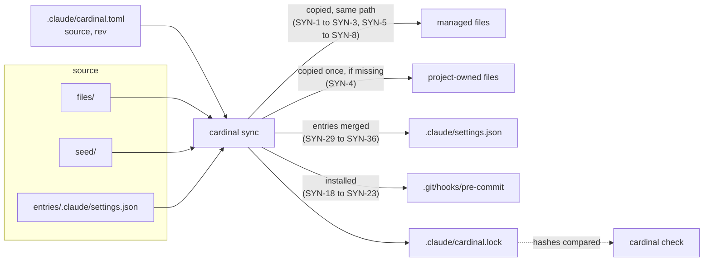
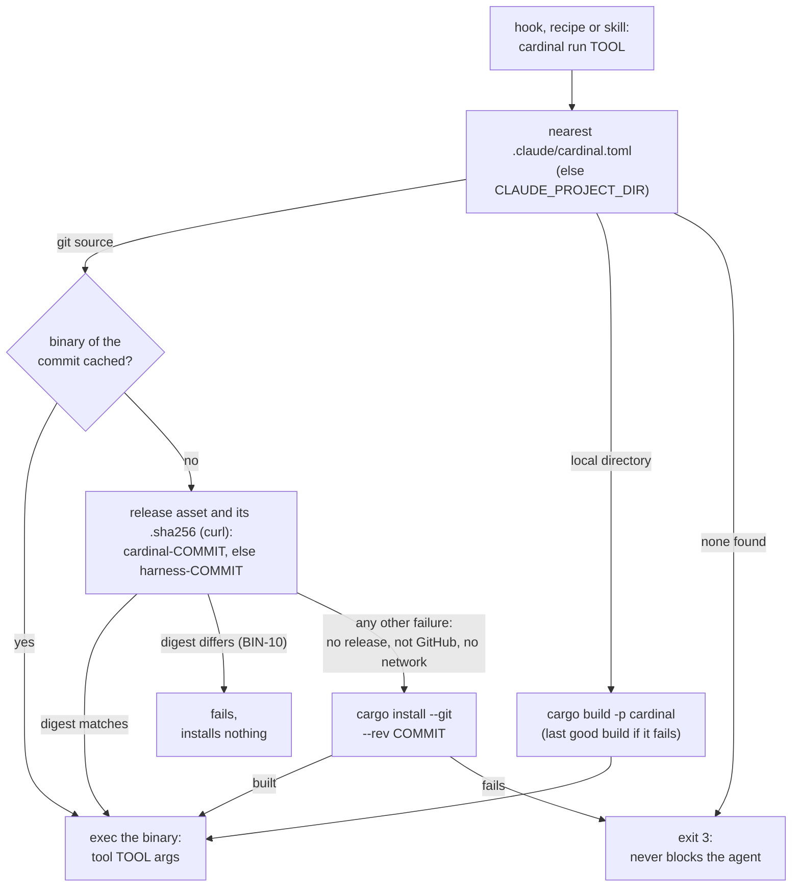
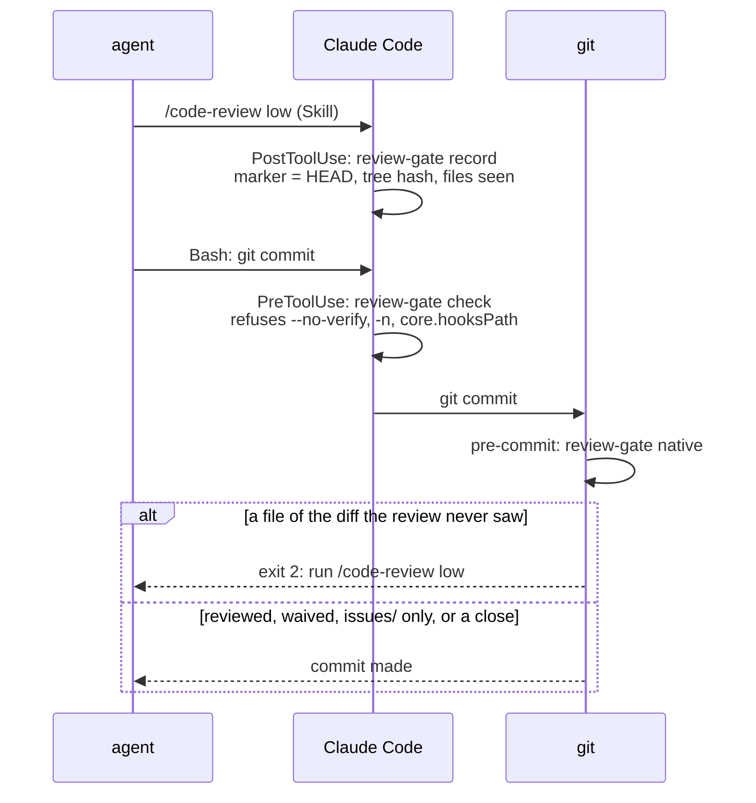
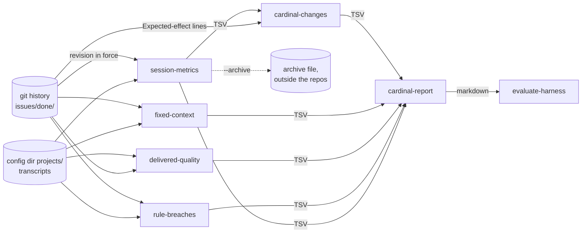

# Architecture

## What is shared, and how

A consumer project holds a `.claude/cardinal.toml`: the `[cardinal]` table (`source`, and `rev` for a git source) and
its own values (`[project]`, read by the tools and the skills). `cardinal sync` reads the source, writes three kinds of
files, records them in the lock and installs the review gate ([ADR 0001](adr/0001-shared-harness-synced-by-a-rust-tool.md), spec [`specs/sync.md`](../specs/sync.md)). It
refuses a source below the format 3, whose projects carry the names before the rename
([ADR 0016](adr/0016-cardinal-syncs-the-format-3-and-higher.md)):

| Kind | From | Examples | Owner |
|---|---|---|---|
| Managed | `files/` | skills, `.claude/rules/` (always-on rules, loaded at launch with no import), `.claude/.gitignore` (ignores the personal configuration), `cardinal.just`, `AGENTS.md`, `specs/README.md`, the CI workflow and its `install_cardinal.sh` | the source: an edit in a project is a conflict |
| Seeded | `seed/` | `.claude/cardinal.toml` defaults, `.claude/settings.json`, `.claude/update-docs-map.md`, `justfile`, `ROADMAP.md` (the milestones the `roadmap` key points at), `CHANGELOG.md` (the header of the sections `release` writes) | the project, from the first copy |
| Entries | `entries/.claude/settings.json` | the hooks, the deny rules of the review waiver and the allow rule of `cardinal run` | the source, inside a file the project owns ("Hooks and their declaration") |

`.claude/cardinal.lock` records the hash of each managed file and each managed entry as written, and the format of
the source it was synced from, which an older `cardinal` refuses to read (SYN-42). A managed file whose
hash differs from the lock was edited locally: `sync` reports a conflict instead of overwriting it and `check` fails.
The fix belongs in this repository, then `sync` everywhere; there is deliberately no merge.

Everything that differs between projects is a value, not code. The tools read lists from `.claude/cardinal.toml`
(`commit_scopes`, `root_docs`, `skipped_dirs`, `spec_files`, `internal_dirs`, `release_breaking_files`), the hooks and
`release` the project's commands (`lint_command`, `lint_files`, `format_command`, `format_files`,
`release_version_command`), and `cardinal` its `fixed_context_budget`; the skills tell the agent
which key to read (`roadmap`, `architecture`, `test_conventions`, `confidential`, `user_language`); the
change-to-documents table of `update-docs` is the project's `.claude/update-docs-map.md`. Anything else project-specific (a quality benchmark, a smoke test, the
language-specific recipes of the `justfile`) stays in the project.

A preference of the person rather than of the project (`user_language` today) is read first from the `[project]`
table of `.claude/cardinal.local.toml`, a file each person writes, git ignores and Cardinal never manages, then from
`.claude/cardinal.toml`, which keeps the default ([ADR 0018](adr/0018-personal-preferences-live-in-a-git-ignored-file.md)).

## Sources

A source is a directory (relative to the project) or a git repository: a URL, or a path ending with `.git` (SYN-49),
which is read as the absolute `file://` URL of that path from the project root (SYN-50). A git source is cloned in
`$XDG_CACHE_HOME/cardinal` and checked out at `rev` (default: the remote's default branch), which pins a commit, not a moving name
([ADR 0002](adr/0002-rev-pins-the-resolved-commit.md)). `cardinal update [--rev <name>]` resolves a name to a commit,
previews the sync, and only then syncs and writes the commit to `rev` (SYN-11 to SYN-17); a local directory has no
revision. `check` compares the project with its lock and never reads the source.

## Tools and their binary

The tools of Cardinal (hooks, checks, issue tools, transcript readers) are modules of the `cardinal` crate, one per
tool under `crates/cardinal/src/tools/`, listed in `TOOLS`
([ADR 0010](adr/0010-the-tools-ship-in-the-harness-binary.md), spec
[`specs/tool-binaries.md`](../specs/tool-binaries.md)). A hook, a recipe or a skill calls `cardinal run <tool> [args]`.
A consumer needs `cardinal` and `just`, and Rust only for a commit with no published binary. The tests of the tools and
of the shared content (`tests/skills.rs`, `tests/settings_hygiene.rs`) are the `cargo test` of this repository;
consumers run none.

The installed `cardinal` is only a launcher (`crates/cardinal/src/run.rs`): it finds the pinned revision and replaces
itself (`exec`) by that revision's binary, so input, output and exit code are the tool's. The binary was named `harness`
before: the release or the build of a commit from before the rename still carries that name (BIN-3, BIN-5).

| Exit | Meaning |
|---|---|
| the tool's | the tool ran |
| 1 | a drift or a conflict of `sync` and `check` |
| 2 | a hook refuses (Claude Code blocks on it) |
| 3 | the launcher could not run the tool, or `init`, `sync`, `update`, `check` failed (BIN-7, BIN-14, BIN-17, SYN-37) |

A binary pinned before BIN-7 exits 2 instead of 3 on a tool it does not know, and a launcher installed before BIN-17
on a subcommand it does not know: the hook then refuses, and with an old launcher every hook does.

The binaries live in `<cache>/cardinal/bin/<commit>/<target>/cardinal`, or `<cache>/cardinal/bin/local-<hash of the
path>/cardinal` for a local source, written next to their place and renamed (BIN-4). A `rev` that is no commit hash (a
branch, from `init --rev`) resolves in the clone `sync` left (`<cache>/cardinal/<hash of the URL>`), without a fetch.
A commit from before the rename is fetched from its `harness-<commit>` release, or built by a `cargo install` that
names no crate, which builds the single package of the commit whatever its name. `sync` and `update` fetch the binary
ahead.

The launcher itself is not of the pinned revision: a hook running a subcommand the installed `cardinal` does not know
cannot run. `check` names the
`cargo install --force` to run (BIN-15) and `update` refuses such a revision (BIN-16);
`crates/cardinal/src/launcher.rs`. Nor does a launcher read a managed content newer than itself: the source declares
its format in `cardinal-format`, `cardinal` reads up to the `FORMAT` compiled in it, and `sync` and `update` refuse a
higher one with the install to run (SYN-40, ADR 0014). The source that raises its format declares the names it
replaced and the seeded texts to rewrite in `migrations/<n>.toml`, which `sync` and `update` apply above the format
of the lock, warning of each line of a tracked project file that still cites an old name; `check` and `sync` hint at
`cardinal update` while the lock is below the `FORMAT` of the binary (`crates/cardinal/src/migration.rs`, SYN-52, ADR 0017).

This repository publishes the binaries (`.github/workflows/release.yml`, its own, not managed): each push to the main
branch builds `cardinal` for `x86_64-unknown-linux-musl`, `aarch64-unknown-linux-musl` (static, so they run whatever
the glibc) and `aarch64-apple-darwin`, and creates the release `cardinal-<commit>` with each binary and its `.sha256`
(a commit from before the rename has its `harness-<commit>` release instead). The CI of a consumer
(`.github/install_cardinal.sh`) reads `source` and `rev` with the runner's Python 3.11+ (`tomllib`, SYN-56), then
installs that asset, or builds it with `cargo` when there is none, so its jobs need no Rust when the source publishes
the commit. The workflow fires on the main branch only: pushing a version tag `v<X.Y.Z>`, made by `release`
(`specs/release.md`), builds nothing; the tag only names a commit a consumer can pin (`cardinal update --rev v0.2.0`).

## Hooks and their declaration

| Event | Matcher | Tool | Does | Spec |
|---|---|---|---|---|
| `PreToolUse` | `Bash` | `review-gate check` | refuses a command that would skip the git hook | [`review-gate.md`](../specs/review-gate.md) REV-12 |
| `PostToolUse` | `Skill` | `review-gate record` | records what the code review saw | [`review-gate.md`](../specs/review-gate.md) |
| `PostToolUse` | `Edit\|Write` | `format-code` | formats an edited file with the project's format command, else `cargo fmt` the project of an edited `.rs` file | [`format-hook.md`](../specs/format-hook.md) |
| `Stop` | | `lint-gate` | blocks the end of a turn while the project's lint (else clippy) reports a problem | [`lint-gate.md`](../specs/lint-gate.md) |
| `Stop` | | `language-hint` | sends the agent back once when its last reply is not in the `user_language`, judged as rule `user-language` of `rule-breaches` (`tools/language.rs`) | [`language-hint.md`](../specs/language-hint.md) |
| git `pre-commit` | | `review-gate native` | refuses a commit whose diff the review never saw | [`review-gate.md`](../specs/review-gate.md) REV-9 |

Claude Code runs a hook only once declared in `.claude/settings.json`, which is seeded and then owned by the project.
The source therefore declares what it manages in `entries/.claude/settings.json`: the hooks above and the
`permissions.deny` rules of the review waiver ([ADR 0007](adr/0007-sync-manages-entries-of-the-seeded-settings.md),
`crates/cardinal/src/entries.rs`), and the `permissions.allow` rule `Bash(cardinal run *)` the managed skills need
([ADR 0013](adr/0013-sync-manages-the-allow-rules-too.md)). `sync` adds the entries the settings lack, removes those the source dropped when they
are unchanged, records them in the lock, and leaves every other key as the project wrote it (SYN-29 to SYN-36). There is
no separate file to own instead: Claude Code reads one shared settings file per project, besides the personal
`settings.local.json`.

`check`, `sync` and `update` warn of what the settings lack or run in vain: a deny rule of the waiver, a hook under
`.claude/hooks/` the project no longer has, an attribution left on (SYN-24 to SYN-27), and a transcript retention under
a year outside CI (SYN-28, `settings::retention`), since the evaluation reads the transcripts of several revisions. They
also warn when the fixed context of the work tree (the memory files a session loads at launch and their imports, the
skill descriptions, measured by `memory.rs` as `fixed-context` measures a revision) exceeds the `fixed_context_budget`
of the project (SYN-38, SYN-39, `budget.rs`): always-on text only grows unless something bounds it. A
test of the crate (`every_tool_the_shared_harness_runs_exists`) fails when a declared hook, a recipe or a skill runs a
tool `cardinal run` does not know.

No hook guards the attribution: the seeded settings turn it off (`"attribution": {"commit": "", "pr": "",
"sessionUrl": false}`), `cardinal run commit-check` rejects a credit line (run by `skill:commit-message` and by CI through
`just check-commits`), and `check` warns of settings that leave it on.

### The review gate

`review-gate` makes the code review of `issue-workflow` (step 3.5) a precondition of the commit. The gates catch the
mistakes of a cooperative agent, not deliberate bypasses
([ADR 0005](adr/0005-the-gates-catch-mistakes-not-bypasses.md)); the judgement moved from the command text to the
repository git resolves ([ADR 0004](adr/0004-review-gate-moves-from-the-command-to-the-repository.md),
`crates/cardinal/src/gate.rs`).

- **record** writes `claude-code-review.json` in the git directory, never in the work tree: the `HEAD`, a hash of the
  working tree against `HEAD` (tracked changes and untracked files) and the files it covers. It does not parse the
  review text. `code-review` runs forked, so the hook fires when the review ends.
- **native** recomputes that snapshot and refuses when the marker is missing, older than the last commit, or the diff
  holds a file the review never saw (REV-9, REV-10); a fix to a reviewed file passes, documentation is reviewed like
  code, and the temporary index of `git commit -a` (`GIT_INDEX_FILE`) is ignored so the snapshot is the one `record`
  took. Each linked worktree has its own marker and waiver (REV-11, REV-15). The commit of a close passes unreviewed
  when, outside `issues/`, its index holds only the references `close-issue` rewrites for the moves it records (REV-20).
- **check** reads a command only for what would skip the git hook (REV-12): a native hook does not run under
  `--no-verify` or `-n`, nor once `core.hooksPath` points elsewhere. A commit made by another tool is out of reach.
- **Waiver**: only the user waives the next commit, with `just waive-review` (it creates `claude-review-waived` at
  `git rev-parse --git-path`, REV-17). The managed deny rules make Claude Code refuse the agent the recipe and an edit
  of the file (REV-19); they match the command the agent usually writes, not a `touch` or a script. A waiver is stamped
  with `HEAD` when it lets a commit through and removed at the first run after `HEAD` moved, so a command that does not
  commit leaves it usable.
- **Install**: `sync` writes the git `pre-commit` (a small `sh` script marked by its second line) in the hooks
  directory of the common git directory, keeps a user's own hook as `pre-commit.user` run after it, and skips a
  `core.hooksPath` set elsewhere (SYN-18 to SYN-23); a project nested in another repository, or outside any, gets
  no gate and no error. `.git/hooks` is not cloned, so each clone needs its own `sync`. A
  missing `cardinal`, or a launcher that cannot run the tool (exit 3), is a warning, not a refusal.

### The code hooks

`lint-gate` runs at the end of a turn the `lint_command` of `.claude/cardinal.toml` (by `sh -c`, from the project
directory) when a file named like one of its `lint_files` changed outside the `.claude` directories, else `cargo clippy`
in a project with a `Cargo.toml` and a changed `.rs` file; in both cases only when the lint state (command, commit,
changed files) changed since the last passing run (CLG-1, CLG-4, CLG-7). What it prints is billed to the agent at each
turn: one short line per clippy diagnostic, at most 40 (CLG-2, CLG-3), the first 40 non-blank lines of another lint
(CLG-8). An empty `lint_command` turns the gate off. `format-code` runs after an edit the `format_command`, with the
edited file as last argument, from the root of its work tree, when the file is named like one of the `format_files`,
else `cargo fmt` for a `.rs` file; it prints nothing (FMT-1 to FMT-4).

The hooks that run cargo do not trust `CLAUDE_PROJECT_DIR`: a session that entered another worktree keeps it on the
main one, where another agent may work. `lint-gate` checks the work tree of the event's `cwd` (CLG-6) and
`format-code` runs `cargo fmt` from the directory of the edited file. For the same reason the seeded `justfile` asks
the project's `check` to print nothing on success.

## The evaluation from the transcripts

Cardinal is judged by what it changes in the sessions, read after the fact from the Claude Code transcripts and the
git history of the projects. The readers are tools of `cardinal`; the skill `evaluate-harness` runs them into a
temporary directory and reports the trend per axis next to the confounders.

| Reader | One row per | Measures | Spec |
|---|---|---|---|
| `session-metrics` | session | tokens, the peak of the main context (sub-agents apart), turns, tool calls, the advisor set and its calls and tokens, hook refusals, skill calls, typed messages | [`evaluation.md`](../specs/evaluation.md) |
| `rule-breaches` | finding (`--summary`: rule and revision) | the rules a program can check, `breach` or `blocked`; a language breach is `hinted`, `final` or `intermediate`; a `skill-routing-<skill>` finding is a trigger met before its skill was loaded; an `oversized-result` finding is a tool result over 25,000 bytes, its size as `detail`, summed in the `bytes` of the summary (empty for the rules that are no waste) | [`rule-breaches.md`](../specs/rule-breaches.md) |
| `delivered-quality` | done issue (`--summary`: revision) | deliverables, fixes inside and after, review findings, failed checks, tokens, traced ids, lines changed in the specs and in the docs | [`delivered-quality.md`](../specs/delivered-quality.md) |
| `fixed-context` | project and revision | the bytes every session pays before any work, the skills shipped | [`cardinal-report.md`](../specs/cardinal-report.md) |
| `cardinal-changes` | expected effect of a change | the `Expected-effect` lines of the commits of `files/`, the revisions in use that hold each | [`cardinal-verdicts.md`](../specs/cardinal-verdicts.md) |
| `cardinal-report` | group of revisions | the tables of the readers above, never the transcripts; a verdict per expected effect | [`cardinal-report.md`](../specs/cardinal-report.md) |

The choices behind them:

- **One reading of the transcripts**: projects, sessions, sub-agents, the typed-message filter and the project and
  revision a session resolves to live once in `transcripts.rs` (EVA-12,
  [ADR 0006](adr/0006-transcript-readers-are-managed-scripts.md), its script form superseded by ADR 0010).
- **The revision in force**: the transcripts do not record it, so it is the `rev` of the `.claude/cardinal.toml`
  committed on the default branch of the project at the start of the session (`self:<commit>` for this repository, the
  last commit touching `files/`), EVA-8. An issue is measured with the revision in force before its first commit
  (QUA-5), so an issue that changes Cardinal counts with the Cardinal revision it was made with.
- **No text**: no reader prints a message, a tool input or a commit text (EVA-10, BRE-11, QUA-10, REP-8), so
  `--archive` can keep the rows outside the repositories and the history outlives the retention of the transcripts.
- **A moving format**: an unreadable line, an unknown type or a missing field counts in its own column rather than
  skewing the others (EVA-9). An archive written before `main_context_peak` or the advisor columns is upgraded with
  empty cells, as the advisor cells of a session that set no advisor are, which the report leaves out of its median,
  counting next to it the sessions it rests on (`peak_sessions`, `advisor_sessions`); a verdict on one of these
  metrics is `confounded` when they are fewer than `--min-sessions` (`no data` when there are none) (EVA-17, EVA-19,
  EVA-20, REP-9, REP-10, REP-11, VRD-9, VRD-10), and a verdict on an advisor metric also when the advisor set changed.
  A verdict on a ratio of the quality table is `confounded` when a group closed fewer issues (of known tokens, for the
  tokens; and also held fewer reviews, for the findings per review) than `--min-issues` (5): an issue spans several
  sessions, and its reviews and lines are not independent (VRD-11, VRD-12).
- **Signals, not verdicts**: medians per session, so one long session does not weigh as ten; groups of consecutive
  revisions of at least `--min-sessions` (10) sessions, since a `self:` revision often covers one issue; the sample
  size and the mix of models, versions and projects next to each number (REP-4, REP-5). The numbers are never turned
  into a pass or a fail, since they would become targets.

`audit-instructions` is the other skill that reads outside the repository: the transcripts, memory and instruction
files under the `projects/` of the configuration directory and its user-level ones, through `audit-sources` ([`instruction-audit.md`](../specs/instruction-audit.md)),
and the summary of `rule-breaches`, whose rules broken often are hook candidates, its waste rules (a `bytes` column filled) apart. It only proposes what more than one session shows, in the cheapest form that holds it (skill,
script or `cardinal` tool, hook, always-on rule last); its report holds private content, so it stays in the
conversation and each validated proposal becomes an issue in generic wording. It is a skill rather than a tool because
telling a repeated procedure from a rule needs judgment.

## Parallel issues

Two agents can drive two issues at once, each in its worktree `.claude/worktrees/<stem>` on a branch `<stem>`: separate
working tree and index, shared object store ([ADR 0003](adr/0003-one-worktree-per-issue.md),
[ADR 0008](adr/0008-issue-worktrees-nest-under-claude-worktrees.md),
[ADR 0011](adr/0011-the-user-opens-the-issue-worktree.md), spec
[`specs/parallel-issues.md`](../specs/parallel-issues.md)). The steps are in [workflow.md](workflow.md#parallel-issues);
the design:

- **Tool**: `cardinal run issue-worktree` (`just start-issue`, `just finish-issue`), `next-issue` and `close-issue`.
- **Taken** is the worktree itself, or a branch holding commits not on the main branch (PAR-3): `next-issue` reads
  `git for-each-ref`, `git worktree list`, `git cherry` and `git merge-tree --write-tree`, so every worktree sees it and
  no file needs cleaning. A leftover branch with neither is listed `Stale:` for `finish-issue` to clean (PAR-4, PAR-6).
- **Personal configuration**: `start-issue` copies the git-ignored `.claude/cardinal.local.toml` of the main
  worktree into the new one (PAR-17), so the person's `user_language` follows them.
- **Nesting**: `start-issue` makes git ignore `/.claude/worktrees/` (PAR-13), and the scanners (`close-issue`,
  `check-specs`, `spec-coverage`) take their files from git (`repo_files.rs`, `git ls-files -co --exclude-standard`, PAR-14,
  [ADR 0009](adr/0009-scanners-list-the-repository-files-through-git.md)), which never lists a nested worktree.
  `close-issue` also drops `.git`, `target`, `node_modules` and the `skipped_dirs` of `.claude/cardinal.toml` by name;
  `check-specs` and `spec-coverage` read every test file of the root (the `.rs` files, or the `spec_files` patterns)
  whatever its layout, but those under `.git`, `node_modules`, a `target` beside a `Cargo.toml` and the `skipped_dirs`
  (TRC-9 to TRC-11).
- **Hooks** act on the work tree of the event's `cwd`: a session launched in the worktree has it as
  `CLAUDE_PROJECT_DIR`, its own `.claude/settings.json` declares them, and `cardinal run` takes the revision of the
  `cardinal.toml` it finds from the `cwd`; the review marker and waiver are per worktree (PAR-9). `.claude/` is tracked,
  so each worktree holds its own copy of Cardinal's files (a project that does not track it gets bare worktrees).
- **Order**: each issue carries its `rank` (ADR 0019), so a branch edits only its own issues; closing happens at
  merge time, in the main worktree (PAR-8).
- **Cost**: each worktree has its own `target/` (measured once, on this repository and a 24-core machine: 239 MB and a
  cold build in 4 s; a larger project may want a shared `CARGO_TARGET_DIR`, which is then the project's choice).

## The cost of a turn

Everything a check prints is read by the agent and billed as tokens, every turn it runs. Measured on this repository
(bytes / 4 ≈ tokens):

| Output | Before | After |
|---|---|---|
| `just check`, success | 86 lines, 5.6 kB | nothing |
| clippy gate, 3 errors | 35 lines, 1.9 kB | 4 lines, 0.4 kB |
| clippy gate, end of turn with no new Rust change | a full clippy run | no run |

The model is the other lever, and the shared settings deliberately do not choose it: it depends on the user's plan
and the project. The setup that costs least for `issue-workflow` is a strong model where judgment matters (steps 1
and 2: preparation in the files, single validation stop; the final `high` review) and a cheaper one for the mechanical part (step 3: test,
code, docs, the `low` review, the commit). Switch with `/model` after the plan is validated; `/model opusplan`
does not fit, since plan mode is read-only and step 1 writes the issue. Forked
skills and sub-agents follow the session model unless the user sets `CLAUDE_CODE_SUBAGENT_MODEL` in their own
settings. An advisor (`/advisor`) is the same split within a turn: a cheaper executor consults a stronger model
at the moments the skill names (section "Advisor").
