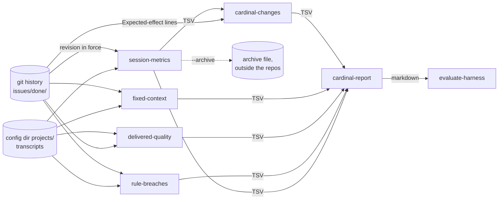

# Evaluation

How Cardinal is judged, in detail; [usage.md](usage.md#evaluating-cardinal) gives the commands.

## From the transcripts

Cardinal is judged by what it changes in the sessions, read after the fact from the Claude Code transcripts and the
git history of the projects. The readers are tools of `cardinal`; the skill `evaluate-harness` runs them into a
temporary directory and reports the trend per axis next to the confounders.

| Reader | One row per | Measures | Spec |
|---|---|---|---|
| `session-metrics` | session | tokens, the peak of the main context (sub-agents apart), turns, tool calls, the advisor set and its calls and tokens, hook refusals, skill calls, typed messages | [`evaluation.md`](../specs/evaluation.md) |
| `rule-breaches` | finding (`--summary`: rule and revision) | the rules a program can check, `breach` or `blocked`; a language breach is `hinted`, `final` or `intermediate`; a `skill-routing-<skill>` finding is a trigger met before its skill was loaded; an `oversized-result` finding is a tool result of the session over 25,000 bytes, its size as `detail` (`oversized-result-review` for a reviewer of `/code-review`, `oversized-result-subagent` for another sub-agent), summed in the `bytes` of the summary (empty for the rules that are no waste) | [`rule-breaches.md`](../specs/rule-breaches.md) |
| `delivered-quality` | done issue (`--summary`: revision and setup) | setup of its sessions, deliverables, fixes inside and after, review findings, failed checks, tokens, traced ids, lines changed in the specs and in the docs | [`delivered-quality.md`](../specs/delivered-quality.md) |
| `fixed-context` | project and revision | the bytes every session pays before any work, the skills shipped | [`cardinal-report.md`](../specs/cardinal-report.md) |
| `cardinal-changes` | expected effect of a change | the `Expected-effect` lines of the commits of `files/`, the revisions in use that hold each | [`cardinal-verdicts.md`](../specs/cardinal-verdicts.md) |
| `cardinal-report` | group of revisions, or setup (`--by setup`) | the tables of the readers above, never the transcripts; a verdict per expected effect | [`cardinal-report.md`](../specs/cardinal-report.md) |

The choices behind them:

- **One reading of the transcripts**: projects, sessions, sub-agents, the typed-message filter and the project and
  revision a session resolves to live once in `transcripts.rs` (EVA-12,
  [ADR 0006](adr/0006-transcript-readers-are-managed-scripts.md), its script form superseded by ADR 0010).
- **The revision in force**: the transcripts do not record it, so it is the `rev` of the `.claude/cardinal.toml`
  committed on the default branch of the project at the start of the session (`self:<commit>` for this repository, the
  last commit touching `files/`), EVA-8. An issue is measured with the revision in force before its first commit
  (QUA-5), so an issue that changes Cardinal counts with the Cardinal revision it was made with.
- **No text**: no reader prints a message, a tool input or a commit text (EVA-10, BRE-11, QUA-10, REP-8), so
  `--archive` can keep the rows outside the repositories and the history outlives the retention of the transcripts.
- **A moving format**: an unreadable line, an unknown type or a missing field counts in its own column rather than
  skewing the others (EVA-9).
- **Empty cells**: an archive written before `main_context_peak` or the advisor columns is upgraded with empty cells,
  as are the advisor cells of a session that set no advisor. The report leaves them out of its median and counts next
  to it the sessions it rests on (`peak_sessions`, `advisor_sessions`) (EVA-17, EVA-19, EVA-20, REP-9 to REP-11).
- **Small samples**: a verdict is `confounded` when the sessions behind a metric of empty cells are fewer than
  `--min-sessions` (`no data` when there are none), and for an advisor metric also when the advisor set changed
  (VRD-9, VRD-10). A verdict on a ratio of the quality table is `confounded` when a group closed fewer issues than
  `--min-issues` (5) (only those of known tokens count for the tokens) or, for the findings per review, also held
  fewer reviews: an issue spans several sessions, and its reviews and lines are not independent (VRD-11, VRD-12).
- **Signals, not verdicts**: medians per session, so one long session does not weigh as ten; groups of consecutive
  revisions of at least `--min-sessions` (10) sessions, since a `self:` revision often covers one issue; the sample
  size and the mix of models, versions and projects next to each number (REP-4, REP-5). The numbers are never turned
  into a pass or a fail, since they would become targets.
- **Setups**: `cardinal-report --by setup` counts a session under its first model, so one switched with `/model`
  counts as the model it started with, and an advisor that is that model as none.

## The replay

Every verdict above is observational: it compares the sessions that happened to run on each revision. The controlled
counterpart, in this repository only, is `just replay <rev> <runs>`: it copies the fixture project of
`fixtures/replay/` into a fresh git repository per run, syncs it to the Cardinal revision `<rev>`, runs `claude -p`
headless on its issue (handed with a validated plan in autonomous mode, so no stop waits for the user), then grades
the run (it ended in `success`, committed, recorded a code review, passes the held-out test of `grade/`) and prints one
tab-separated line per run, billed to the user's plan. Its transcripts are read by `session-metrics` like any other
(project `replay-fixture`, revision the pinned commit). One task for now: a set of reference tasks comparing two
variants is not built yet.

## The instruction audit

`audit-instructions` is the other skill that reads outside the repository: the transcripts, memory and instruction
files under the `projects/` of the configuration directory and its user-level ones, through `audit-sources`
([`instruction-audit.md`](../specs/instruction-audit.md)), and the summary of `rule-breaches`, whose rules broken
often are hook candidates, its waste rules (a `bytes` column filled) apart.

- It only proposes what more than one session shows, in the cheapest form that holds it (skill, script or `cardinal`
  tool, hook, always-on rule last).
- Its report holds private content, so it stays in the conversation and each validated proposal becomes an issue in
  generic wording.
- It is a skill rather than a tool because telling a repeated procedure from a rule needs judgment.
- Its second mode reads only the repository: it reviews the shipped instructions for contradictions, duplicates,
  stale and mechanical rules, and fixes the accepted ones one family per deliverable.
