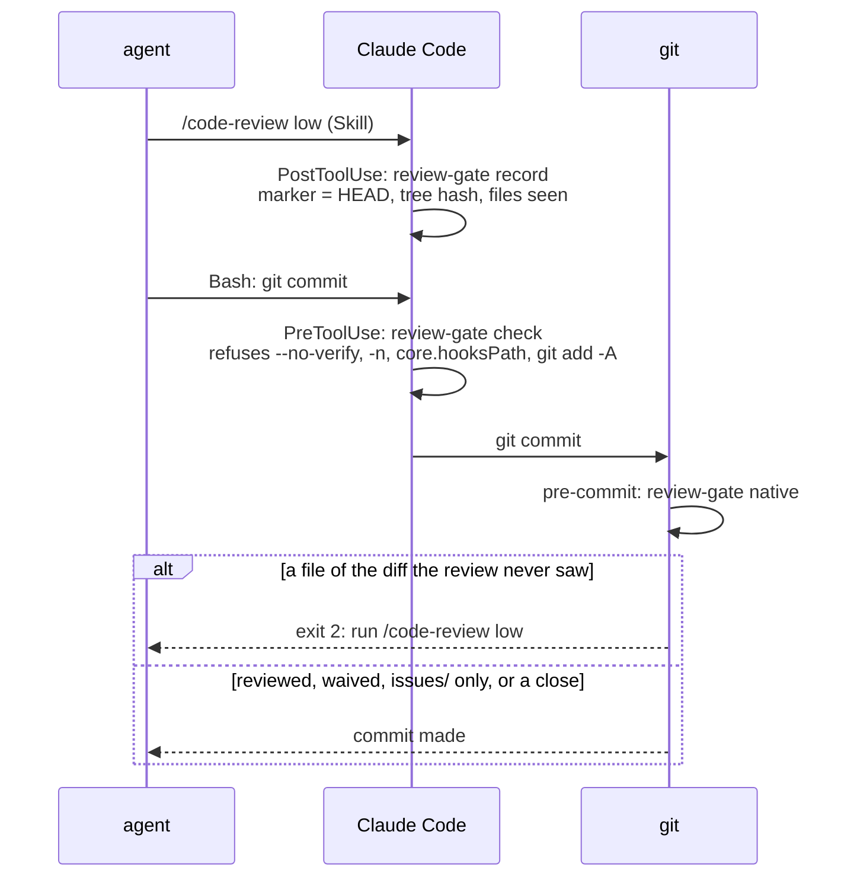

# Gates

The hooks that hold the agent to the rules of a project, in detail;
[architecture.md](architecture.md#hooks-and-their-declaration) lists them and says how `sync` declares them.

## The review gate

`review-gate` makes the code review of `issue-workflow` (step 3.5) a precondition of the commit. The gates catch the
mistakes of a cooperative agent, not deliberate bypasses
([ADR 0005](adr/0005-the-gates-catch-mistakes-not-bypasses.md)); the judgement moved from the command text to the
repository git resolves ([ADR 0004](adr/0004-review-gate-moves-from-the-command-to-the-repository.md),
`crates/cardinal/src/gate.rs`).

- **record** writes `claude-code-review.json` in the git directory, never in the work tree: the `HEAD`, a hash of the
  working tree against `HEAD` (tracked changes and untracked files) and the files it covers. It does not parse the
  review text. `code-review` runs forked, so the hook fires when the review ends.
- **native** recomputes that snapshot and refuses when the marker is missing, older than the last commit, or the diff
  holds a file the review never saw (REV-9, REV-10); a fix to a reviewed file passes, documentation is reviewed like
  code, and the temporary index of `git commit -a` (`GIT_INDEX_FILE`) is ignored so the snapshot is the one `record`
  took. Each linked worktree has its own marker and waiver (REV-11, REV-15). The commit of a close passes unreviewed
  when, outside `issues/`, its index holds only the references `close-issue` rewrites for the moves it records and
  the milestones it sets `done`, recomputed from the index (REV-20). With the feature `issue-files` off, `issues/` passes unreviewed in no
  case: a project tracking its issues elsewhere may hold its own code there (FEA-36).
- **check** reads a command only for what would skip the git hook (REV-12): a native hook does not run under
  `--no-verify` or `-n`, nor once `core.hooksPath` points elsewhere. A commit made by another tool is out of reach.
- **Waiver**: only the user waives the next commit, with `just waive-review` (it creates `claude-review-waived` at
  `git rev-parse --git-path`, REV-17). The managed deny rules make Claude Code refuse the agent the recipe and an edit
  of the file (REV-19); they match the command the agent usually writes, not a `touch` or a script. A waiver is stamped
  with `HEAD` when it lets a commit through and removed at the first run after `HEAD` moved, so a command that does not
  commit leaves it usable.
- **Install**: `sync` writes the git `pre-commit` (a small `sh` script marked by its second line) in the hooks
  directory of the common git directory, keeps a user's own hook as `pre-commit.user` run after it, and skips a
  `core.hooksPath` set elsewhere (SYN-18 to SYN-23); a project nested in another repository, or outside any, gets
  no gate and no error. A user's hook whose `pre-commit.user` already exists is never overwritten: `sync` fails and
  `check` names the conflict to merge by hand (SYN-19, SYN-23), unless it is a hard link of that hook, which a
  `sync` killed mid-install leaves: the next `sync` finishes the install. `.git/hooks` is not cloned, so each clone needs its
  own `sync`. A missing `cardinal`, or a launcher that cannot run the tool (exit 3), is a warning, not a refusal.
- **Uninstall**: once the source no longer manages a hook of the gate, `sync` removes the `pre-commit` it marked and
  moves `pre-commit.user` back in its place (SYN-60); a gate left alone would refuse every commit.
- **Turned off**: the gate is the feature `review-gate` of `features.toml` (FEA-23): a project that reviews in pull
  requests, or a solo user, lists it in `disabled`, and `sync` removes its hooks, the deny rules, `waive-review` and
  the native gate; `check` then expects none of them (FEA-24, FEA-25), and `rule-breaches` no longer counts its rules
  in the sessions that start once the change is committed on the default branch (FEA-26).

## The code hooks

- **`lint-gate`**, at the end of a turn, runs the `lint_command` of `.claude/cardinal.toml` (by `sh -c`, from the
  project directory) when a file named like one of its `lint_files` changed outside the `.claude` directories, else
  `cargo clippy` in a project with a `Cargo.toml` and a changed `.rs` file; in both cases only when the lint state
  (command, commit, changed files) changed since the last passing run (CLG-1, CLG-4, CLG-7). What it prints is billed
  to the agent at each turn: one short line per clippy diagnostic, at most 40 (CLG-2, CLG-3), the first 40 non-blank
  lines of another lint (CLG-8). An empty `lint_command` turns the gate off, but the hook still runs at each turn;
  `disabled = ["lint-gate"]` drops its call.
- **`format-code`**, after an edit, runs the `format_command` with the edited file as last argument, from the root of
  its work tree, when the file is named like one of the `format_files`, else `cargo fmt` for a `.rs` file; it prints
  nothing (FMT-1 to FMT-4).

Each code hook is also a feature of `features.toml`, as are the `language-hint` and `read-hint` hooks: a project whose
lint runs in CI, whose editor formats, that works in English only or whose agent reads its files whole on purpose drops
the hook call with `disabled` (FEA-16, RDH-6, `specs/features.md`).

`read-hint`, before a `Read` with neither `offset` nor `limit` whose result would hold more than 25,000 bytes (the
threshold of rule `oversized-result`, BRE-19; estimated as Claude Code reads: the first 2,000 lines, each cut at 2,000
characters, and their line numbers), denies the call with a reason naming the estimate, the range options and `Grep`;
it records the file in `cardinal-read-hint/<session_id>` of `XDG_RUNTIME_DIR` (else `cardinal-read-hint-<USER>` of
the temporary directory, mode 0700), so the same call repeated goes through: a file may be needed whole. Images, PDFs
and notebooks, which Claude Code renders, and files over 256 KB, which it refuses whole itself, pass (RDH-1 to RDH-7). A hint by `additionalContext` alone would
not spare the read it fires on: the tool runs anyway.

The hooks that run cargo do not trust `CLAUDE_PROJECT_DIR`: a session that entered another worktree keeps it on the
main one, where another agent may work. `lint-gate` checks the work tree of the event's `cwd` (CLG-6) and
`format-code` runs `cargo fmt` from the directory of the edited file. For the same reason the seeded `justfile` asks
the project's `check` to print nothing on success.

## The worktree lock

`workspace-lock` keeps one Claude Code session per worktree, since two would share its files, index, review marker and
build output, and an editor's agent client opens several threads on one folder
([ADR 0022](adr/0022-a-session-claims-its-issue-and-locks-its-workspace.md), spec
[`workspace-lock.md`](../specs/workspace-lock.md)). The lock is `cardinal-session` in the git directory of the
worktree (per worktree, WSL-9), holding the `session_id` of the event and the process of the session (`CLAUDE_PID`).

- **`check`** (`PreToolUse` on `Bash|Edit|Write|NotebookEdit`) takes the lock when it is free, when its process no
  longer runs (a killed session skips `SessionEnd`) or when it names the same session or process (a resumed or
  cleared one), and lets the call through; while another live session holds it, it refuses the call (exit 2). The
  read-only tools stay open.
- **`start`** (`SessionStart`, which cannot block) takes the lock, or tells the agent the worktree is busy.
- **`release`** (`SessionEnd`) deletes the lock of its own session.

The changes of the lock run under a mutex directory beside it, created atomically, so two sessions starting at once
leave one holder (WSL-4). A broken event, no git repository or no `CLAUDE_PID` lets the call through (WSL-7).

The three hooks are the feature `workspace-lock` of `features.toml`: a user who never runs two sessions in one
worktree drops their calls with `disabled`, the issue claims staying (FEA-35, `specs/features.md`).

## Attribution

No hook guards it: the seeded settings turn it off (`"attribution": {"commit": "", "pr": "", "sessionUrl": false}`),
`cardinal run commit-check` rejects a credit line (run by `skill:commit-message` and by CI through
`just check-commits`), `.claude/rules/no-ai-attribution.md` states the rule, and `check` warns of settings that leave
it on. All of it is the feature `no-ai-attribution`: a project that turns it off (`disabled`, `specs/features.md`)
loses the rule file at the next `sync`, and these checks, `check-issue` and rule `commit-attribution` of
`rule-breaches` accept a credit line; its seeded `attribution` setting stays its own to change.
