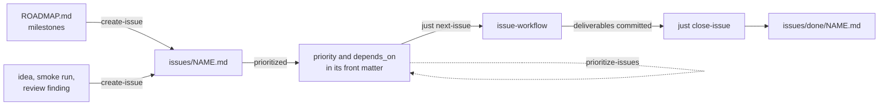
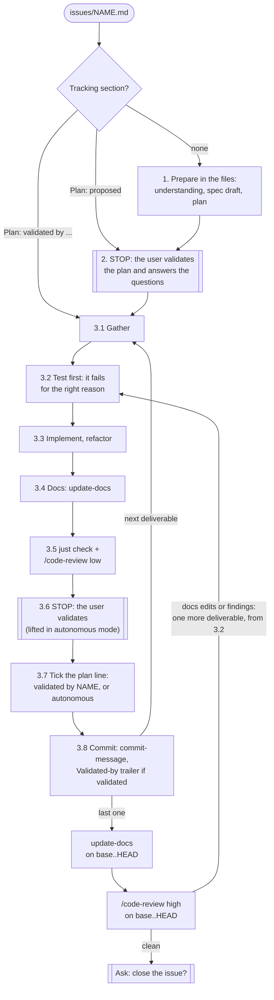
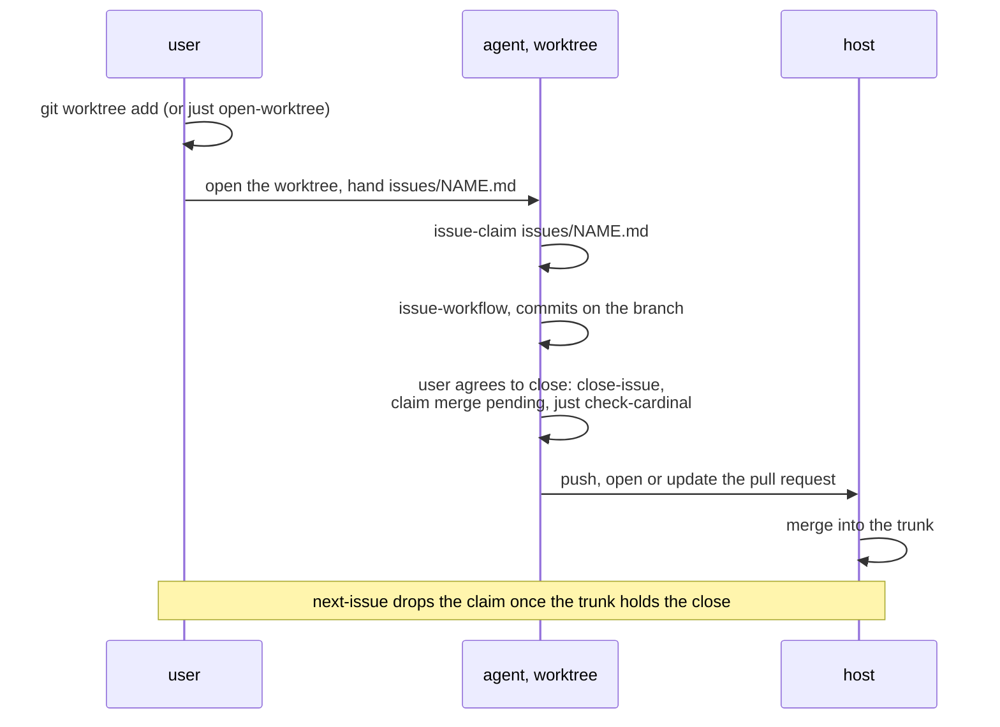

# Workflow

How work goes from an idea to a merged change, with the skills and recipes of Cardinal. The skills hold the
procedure (`.claude/skills/<name>/SKILL.md`); this page shows how they fit together.

## The life of an issue

| Step | Who | Tool |
|---|---|---|
| Plan the milestones | user orders them, agent drafts | the `roadmap` documents of `.claude/cardinal.toml` (`ROADMAP.md` when seeded); `skill:create-issue` cuts a shaped one into issues |
| Write the issue (Goal, Findings, Approach, Resources) | agent, attached to a milestone | `skill:create-issue`, checked by `just check-issue` |
| Prioritize it | agent proposes, user decides | `priority`, `depends_on` and `why` in the front matter of the issue (ADR 0021), `skill:prioritize-issues` to review them all |
| Pick the next one | anyone | `just next-issue`: the first ready issue (by milestone, priority, age) no claim, branch or worktree has taken, then the blocked ones |
| Drive it to done | agent, with one validation stop | `skill:issue-workflow` |
| Close it | agent, on the user's agreement | `just close-issue issues/NAME.md`: moves it to `issues/done/`, frees its claim (`merge pending` on a branch other than the trunk, until the pull request is merged), sets its milestone `done` when it was the last open issue of it (CLS-8), stages the close for a bare `git commit` (CLS-9) and prints the next issue |
| Release | agent, on the user's validation of its proposal when `close-issue` sets a milestone `done` (each writing form asks the user's permission, auto mode included) | `cardinal run release <version>` writes the `CHANGELOG.md` section and marks the milestone `Released:`; the user rereads, the agent commits, `cardinal run release <version> --tag`; the user pushes the tag |

## Inside issue-workflow

- **One validation stop** (step 2): the plan, the questions as a numbered table (`1 a, 2 c`, or `ok` for the
  recommendations) and the mode. Every answer goes to `## Decisions` of the issue.
- **Autonomous mode** (the default) lifts the stop of step 3.6: the summary of each deliverable is written in the
  issue instead and the agent chains into the next one, until a question, a finding or a check it cannot settle.
  What it never lifts is in the skill, section "Autonomous mode".
- **A queue of issues**: handed the next few issues (3 at most), the session claims each one `next-issue` offers,
  writes their plans, stops once for all of them and commits them, then chains them, checking before each one that the
  issues done left its plan valid; one final report, each issue closed when done if the user agreed at the stop. The
  main loop drives it, no subagent per issue ([ADR 0026](adr/0026-a-queue-of-issues-is-chained-by-the-main-loop.md));
  the steps are in the skill's `details.md`, "Drive a queue".
- **Size limit**: an issue too large for one session is split at step 2 (the limits are in step 1 of the skill);
  `cardinal run deliverable-size` counts a deliverable at step 3.5 and what the issue changed since its base commit.
- **Review target**: `cardinal run review-target` gives `/code-review` its target, the diff without `issues/` nor the
  managed copies of `.claude/cardinal.lock`, for the `low` review of a deliverable and the `high` one of the issue;
  `bytes_per_session:oversized-result-review` in `cardinal-report` measures the effect.
- **Specs**: when the issue changes what a capability does, in a project that has `specs/README.md` (the feature
  `specs` on), `skill:write-spec` writes its requirements at step 1 and the tests of step 3.2 carry their
  `// spec: ID` ([specs/README.md](../specs/README.md)). A capability older than its spec gets one read back from its
  code and tests (`skill:write-spec`, "Bootstrap the spec of an existing capability"), picked from
  `just spec-coverage`.
- **Advisor**: when an advisor is configured, the agent consults it at the few moments the skill names (section
  "Advisor"); it never replaces a review or a stop. `advisor_calls` in `cardinal-report` measures the effect.
- **Docs over the issue**: after the last deliverable, `update-docs` reads the user pages and the `architecture`
  document the issue touched whole, so the patches of each deliverable add up to a consistent page;
  `doc_lines_per_spec_line` in `cardinal-report` measures the effect.
- **Gates**: a commit fails while its diff holds a file the last review never saw; only the user can waive it, with
  `just waive-review` ([gates](gates.md#the-review-gate)).

## Parallel issues

An issue usually runs in the main worktree, on the trunk. For two issues at once, the user opens another worktree
on a branch they pick, so the files, index and `target/` of one session never reach the other; a
worktree serves several issues in turn
([ADR 0011](adr/0011-the-user-opens-the-issue-worktree.md),
[ADR 0022](adr/0022-a-session-claims-its-issue-and-locks-its-workspace.md), specs
[`parallel-issues.md`](../specs/parallel-issues.md), [`issue-claim.md`](../specs/issue-claim.md),
[`workspace-lock.md`](../specs/workspace-lock.md)).

- The agent never creates, enters or leaves a worktree: a session entered with `EnterWorktree` or `claude --worktree`
  is isolated by Claude Code, which refuses every command it cannot prove stays there.
- The claim (`cardinal run issue-claim`, step 0 of `issue-workflow`) makes `just next-issue` skip the issue in every
  worktree, the main one included; a branch named after the issue (made by the former `start-issue`) still does too.
- The `workspace-lock` hooks keep one live session per worktree: a second thread on the same folder has its edits
  and commands refused. A project that turns the feature `workspace-lock` off loses that guard; the claim stays.
- `close-issue` runs in the worktree of the issue, never on an issue of another worktree; on a branch other than
  the trunk it leaves the claim `merge pending`, which `next-issue` drops once the trunk holds the close. A branch
  prioritizes only its own issues, so two branches never conflict over the order.
- `just check-cardinal` before the merge catches a hook the installed `cardinal` would refuse once merged; run the
  install it prints first.
- A worktree the former `start-issue` nested under `.claude/worktrees/` is still read by the project's own tools run
  on `.`: remove it with `just close-worktree` once its branch is merged
  ([usage.md](usage.md#parallel-issues-in-worktrees)).

## Evaluating Cardinal

`skill:evaluate-harness` reads the session transcripts and the git history and reports, per Cardinal revision (or per model setup),
whether the agent got more efficient, the delivered work better and the rules better followed
([evaluation](evaluation.md)). A commit that changes `files/` names the
effect it should have in an `Expected-effect: <metric> <up|down>` line (`CLAUDE.md`); the report gives each one a
verdict, `confounded` when something else changed too. `skill:audit-instructions` reads the instructions the user
gave over time and proposes the skills, tools, hooks and rules worth adding; each validated proposal becomes an
issue. Its other mode reviews the shipped instructions for contradictions, duplicates, stale and mechanical
rules, then fixes the accepted ones one family per deliverable.
