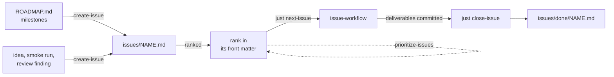
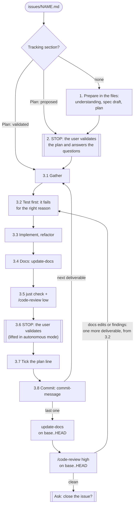
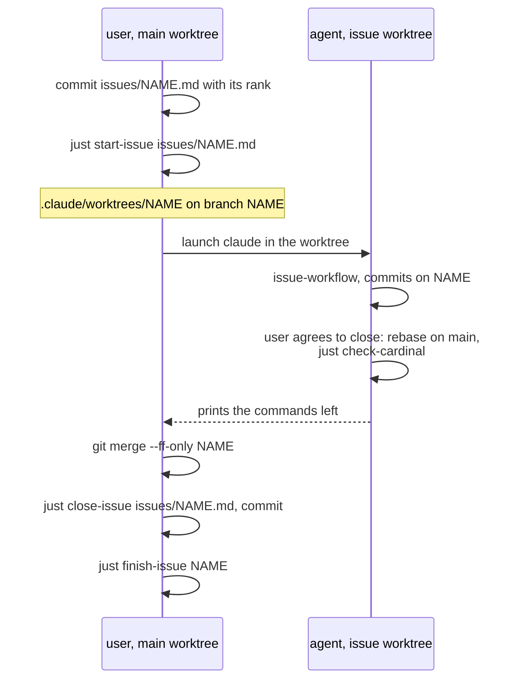

# Workflow

How work goes from an idea to a merged change, with the skills and recipes of Cardinal. The skills hold the
procedure (`.claude/skills/<name>/SKILL.md`); this page shows how they fit together.

## The life of an issue

| Step | Who | Tool |
|---|---|---|
| Plan the milestones | user orders them, agent drafts | the `roadmap` documents of `.claude/cardinal.toml` (`ROADMAP.md` when seeded); `skill:create-issue` cuts a shaped one into issues |
| Write the issue (Goal, Findings, Approach, Resources) | agent, attached to a milestone | `skill:create-issue`, checked by `just check-issue` |
| Rank it | agent proposes, user decides | `rank` and `why` in the front matter of the issue (ADR 0019), `skill:prioritize-issues` to re-rank all |
| Pick the next one | anyone | `just next-issue`: the open issue of lowest rank no branch or worktree has taken |
| Drive it to done | agent, with one validation stop | `skill:issue-workflow` |
| Close it | agent in the main worktree, on the user's agreement; the user after a parallel issue | `just close-issue issues/NAME.md`: moves it to `issues/done/` and prints the next issue; the agent sets its milestone `done` when it was the last |
| Release | user, on the agent's proposal when a milestone becomes `done` | `just release <version>` writes the `CHANGELOG.md` section and marks the milestone `Released:`; reread, commit, `just release <version> --tag`; the user pushes the tag |

## Inside issue-workflow

- **One validation stop** (step 2): the plan, the questions as a numbered table (`1 a, 2 c`, or `ok` for the
  recommendations) and the mode. Every answer goes to `## Decisions` of the issue.
- **Autonomous mode** (the default) lifts the stop of step 3.6: the summary of each deliverable is written in the
  issue instead and the agent chains into the next one, until a question, a finding or a check it cannot settle.
  What it never lifts is in the skill, section "Autonomous mode".
- **Size limit**: an issue too large for one session is split at step 2 (the limits are in step 1 of the skill).
- **Delegated exploration**: only a wide search (the git history, many files of a large repository) at step 1 or 3.1
  goes to a read-only `Explore` subagent, which returns its conclusion with the paths and lines behind it;
  `main_context_peak` in `cardinal-report` measures the effect.
- **Specs**: when the issue changes what a capability does, `skill:write-spec` writes its requirements at step 1
  and the tests of step 3.2 carry their `// spec: ID` ([specs/README.md](../specs/README.md)). A capability older than its spec gets one
  read back from its code and tests (`skill:write-spec`, "Bootstrap the spec of an existing capability"), picked from
  `just spec-coverage`.
- **Advisor**: when an advisor is configured, the agent consults it at the few moments the skill names (section
  "Advisor"); it never replaces a review or a stop. `advisor_calls` in `cardinal-report` measures the effect.
- **Docs over the issue**: after the last deliverable, `update-docs` reads the user pages and the `architecture`
  document the issue touched whole, so the patches of each deliverable add up to a consistent page;
  `doc_lines_per_spec_line` in `cardinal-report` measures the effect.
- **Gates**: a commit fails while its diff holds a file the last review never saw; only the user can waive it, with
  `just waive-review` ([architecture](architecture.md#the-review-gate)).

## Parallel issues

An issue usually runs in the main worktree. For two issues at once, the user gives the second its own worktree, so
the files, index and `target/` of one session never reach the other
([ADR 0003](adr/0003-one-worktree-per-issue.md), [ADR 0011](adr/0011-the-user-opens-the-issue-worktree.md), spec
[`specs/parallel-issues.md`](../specs/parallel-issues.md)).

- The agent never creates, enters or leaves a worktree: a session entered with `EnterWorktree` or `claude --worktree`
  is isolated by Claude Code, which refuses every command it cannot prove stays there.
- While the branch or the worktree exists, `just next-issue` skips the issue for every other session.
- An issue is closed only in the main worktree: `close-issue` refuses in a linked one. A branch ranks only its own
  issues, so two branches never conflict over the order.
- `just check-cardinal` before the merge catches a hook the installed `cardinal` would refuse once merged; run the
  `cargo install` it prints first.
- The project's own tools run on `.` may read the nested worktrees: [usage.md](usage.md#parallel-issues-in-worktrees)
  says how to keep them out.

## Evaluating Cardinal

`skill:evaluate-harness` reads the session transcripts and the git history and reports, per Cardinal revision (or per model setup),
whether the agent got more efficient, the delivered work better and the rules better followed
([architecture](architecture.md#the-evaluation-from-the-transcripts)). A commit that changes `files/` names the
effect it should have in an `Expected-effect: <metric> <up|down>` line (`CLAUDE.md`); the report gives each one a
verdict, `confounded` when something else changed too. `skill:audit-instructions` reads the
instructions the user gave over time and proposes the skills, tools, hooks and rules worth adding; each validated proposal becomes
an issue.
